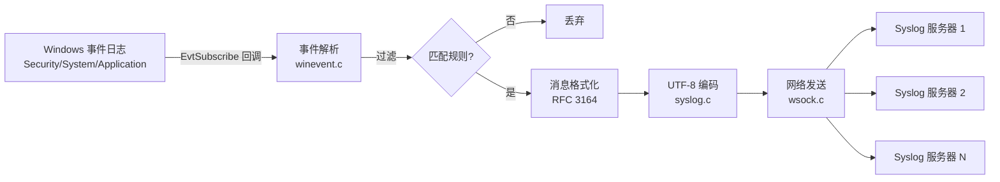

# evtsys — Windows 事件日志转发到 Syslog

evtsys 是一个轻量级 Windows 服务，用于将 Windows 事件日志（Event Log）实时转发到一个或多个 Syslog 服务器。它以 Windows 服务形式常驻运行，支持现代 Windows 事件订阅 API（Vista / Server 2008 及以后，含 Windows 11 / Windows Server 2022）以及旧版事件日志轮询。

本项目 fork 自 [zensquare/evtsys](https://github.com/zensquare/evtsys)（Eventlog to Syslog），当前版本 **5.0.0**，在原 4.5.1 基础上完成了安全性与稳定性修复，详见 [CHANGELOG.md](CHANGELOG.md) 与 [REPORT.md](REPORT.md)。

## 功能特性

- 以 Windows 服务运行（自动启动，异常退出自动重启）
- 基于 `EvtSubscribe` 的实时事件订阅（XPath 过滤），支持多渠道
- 兼容旧版事件日志（Win9x / Server 2003 轮询模式）
- RFC 3164 格式输出（时间戳、主机名、TAG、事件来源、EventID）
- UDP / TCP Syslog 输出（TCP 带 RFC 6587 换行分帧）
- 最多同时转发到 6 个 Syslog 服务器（多目标广播）
- 按事件来源 / EventID / XPath 的忽略与包含过滤
- 登录事件精简插件（LogonGuid:用户名:工作站:IP）
- 安全审计关键字标记（`AUDIT_FAILURE` / `AUDIT_SUCCESS`）
- UTF-8 编码输出，支持中文事件消息
- 可选 DHCP 方式自动发现 Syslog 服务器
- 可选周期性状态消息（含格式化失败 / 发送失败计数）

## 系统要求

- Windows Vista / Server 2008 及以上（推荐 Windows 10 / 11 / Server 2016+）
- 构建需要 Visual Studio（含 C++ 桌面开发工具）或 MSVC Build Tools

## 构建

使用 Visual Studio 打开 `Eventlog to Syslog.sln` 直接生成；或在开发者命令行中：

```bat
msbuild "Eventlog to Syslog.vcxproj" /p:Configuration=Release /p:Platform=Win32
```

> 原工程工具集为 v120（VS2013）。在新版 Visual Studio 中打开时按提示重定解决方案目标即可，或在命令行用 `/p:PlatformToolset=v143` 覆盖。

也可以直接用 MSVC 编译器编译（调试验证用）：

```bat
cl /D_CRT_SECURE_NO_WARNINGS *.c advapi32.lib wsock32.lib dhcpcsvc.lib iphlpapi.lib ^
   user32.lib ws2_32.lib dnsapi.lib wevtapi.lib delayimp.lib
```

## 安装与使用

```bat
:: 安装服务（必须指定 Syslog 服务器）
evtsys.exe -i -h 192.168.1.10

:: 安装并指定端口、设施、TAG
evtsys.exe -i -h 192.168.1.10 -p 514 -f local0 -t evtsys

:: 多个服务器用 ';' 分隔
evtsys.exe -i -h 10.0.0.1;10.0.0.2 -f daemon

:: 启动服务
net start EvtSys

:: 卸载服务（需先停止）
net stop EvtSys
evtsys.exe -u

:: 调试模式（前台运行，输出到控制台）
evtsys.exe -d -h 192.168.1.10
```

### 命令行参数

| 参数 | 说明 |
|------|------|
| `-i` | 安装服务 |
| `-u` | 卸载服务 |
| `-d` | 调试模式：以前台控制台程序运行 |
| `-a` | 在消息中使用本机 IP/FQDN 而非计算机名 |
| `-h hosts` | Syslog 服务器地址，多个用 `;` 分隔（安装时必填） |
| `-f facility` | Syslog facility（auth/daemon/local0…/user，默认 daemon） |
| `-l level` | 转发的最低级别：0=全部/Verbose，1=Critical，2=Error，3=Warning，4=Info |
| `-n` | （仅旧版模式）只转发配置文件中列出的事件 |
| `-p port` | Syslog 端口（默认 514） |
| `-q bool` | 是否通过 DHCP 查询 Syslog 服务器（0/1） |
| `-t tag` | 作为 program 字段写入消息的 TAG |
| `-s minutes` | 状态消息间隔（分钟），0=禁用 |

### 配置文件

配置文件为程序目录下的 `evtsys.cfg`，每行一条规则：

```
' 以单引号开头的行为注释
' 忽略/包含规则：来源:EventID
Security:4688
'*:1001

' XPath 订阅规则（现代 Windows 事件）
XPath:default:Security:*[System[(EventID=4624 or EventID=4625)]]
XPath:login:Security:*[System[(EventID=4624)]]
```

- `来源:EventID` — 旧版模式的忽略清单（`-n` 时为包含清单）；`*` 为通配符
- `XPath:plugin:channel:query` — 现代模式的事件订阅；`plugin` 为 `default` 或 `login`（登录事件精简插件）

程序首次启动时会自动生成带注释的示例配置文件。

## 工作原理



服务生命周期由 SCM 管理：`SERVICE_CONTROL_STOP` 仅发出停止事件，主循环唤醒后完成订阅销毁与网络清理，再上报 `SERVICE_STOPPED`，控制回调永不阻塞。

## 文档

- [CHANGELOG.md](CHANGELOG.md) — 版本变更记录
- [REPORT.md](REPORT.md) — 项目详细报告（代码逻辑、依赖关系、缺陷修复记录、路线图）
- [evtsys-修改建议.md](evtsys-修改建议.md) — 原始审查与改造建议文档

## 已知限制（v5.0.0）

- 消息仍为 RFC 3164 格式；RFC 5424、TLS（RFC 5425）、IPv6、域名服务器解析计划在 v5.2
- 发送失败仅计数并报告，暂无本地持久化队列（断网期间的事件无法补发）；Bookmark 断点续传与磁盘队列计划在 v5.1
- 消息最大长度 1024 字符（超出截断）；TCP 模式下不提供端到端确认

## 许可证

BSD 风格许可，见 [license](license)。本产品包含 Rochester Institute of Technology 与 Purdue University 开发的软件。
