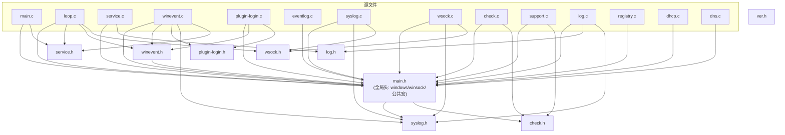
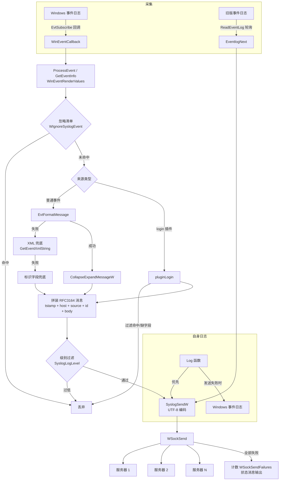
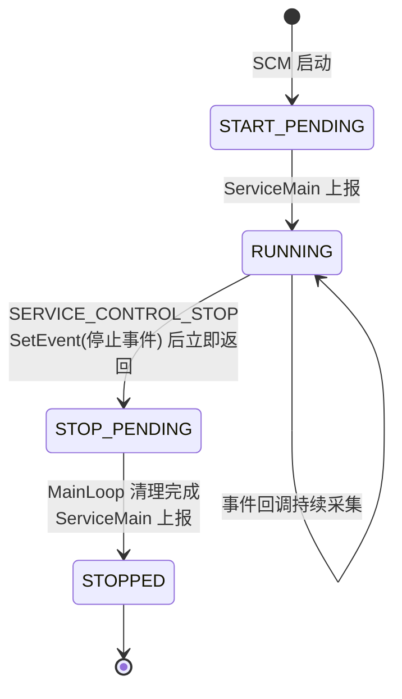

# evtsys 项目详细报告

> 版本：5.0.0（基于 zensquare/evtsys 4.5.1 改造）  
> 报告日期：2026-10-28  
> 范围：代码逻辑梳理、依赖关系、`evtsys-修改建议.md`（v5.0 部分）落实记录、构建验证、遗留问题

---

## 1. 项目概述

evtsys 是一个轻量级 Windows 日志代理：以 Windows 服务常驻运行，订阅 Windows 事件日志（Event Log），将事件格式化为 RFC 3164 Syslog 消息后转发到一个或多个 Syslog 服务器（UDP/TCP）。

- **代码规模**：15 个 C 源文件 + 8 个头文件，约 4,600 行（不含构建/资源文件）
- **技术栈**：C（MSVC）、Windows 原生 API（SCM、Event Log API `wevtapi`、Winsock2、注册表、DHCP 客户端 API）
- **两种采集模式**（运行时自动探测，见 `CheckForWindowsEvents()`）：
  - **现代模式**（Vista / Server 2008+）：`EvtSubscribe` 实时订阅 + XPath 过滤，回调式处理；
  - **传统模式**（Win9x / Server 2003）：轮询 `OpenEventLog`/`ReadEventLog`，逐条处理。
- **许可证**：BSD 风格（RIT / Purdue University 版权声明保留）

---

## 2. 代码结构与模块职责

| 模块 | 行数 | 职责 |
|------|------|------|
| `main.c` / `main.h` | 371 / 153 | 程序入口、命令行参数解析（`-i/-u/-d/-h/-f/-p/-t/-s/-q/-l/-n/-a`）、编排安装/卸载/运行、控制台 Ctrl+C 处理；`main.h` 为全局头（Windows 头、公共宏 `COUNT_OF`、公共原型） |
| `loop.c` | 180 | `MainLoop()`：加载配置、订阅事件或打开传统事件日志、主循环（传统模式轮询 + 周期状态消息 + 停止事件等待）、退出清理 |
| `service.c/h` | 210 / 44 | Windows 服务生命周期：安装（含失败自动重启策略）、卸载、`ServiceMain`/`ServiceChange` 状态机、停止事件（`ServiceStopEvent`/`ServiceSignalStop`） |
| `winevent.c/h` | 700 / 65 | 现代事件订阅核心：`WinEventSubscribe`（多 XPath 订阅）、`WinEventCallback`（投递/错误）、`ProcessEvent`（解析、过滤、格式化、发送）、`WinEventRenderValues`（统一 EvtRender 缓冲）、`GetEventXmlString`（XML 兜底）、`WinEventTimeToString` |
| `plugin-login.c/h` | 90 / 4 | 登录事件精简插件：提取 LogonGuid / TargetUserName / WorkstationName / IpAddress，过滤机器账户（`*$`）与 `MSOL_*` 账户 |
| `eventlog.c/h` | — | 传统模式：`EventlogsOpen/Next/Close`，读取旧版事件日志、格式化消息（消息 DLL） |
| `syslog.c/h` | 180 / 174 | Syslog 消息封装：PRI 头、UTF-16→UTF-8 转换、`SyslogSend`/`SyslogSendW`；配置变量（主机、端口、facility、TAG、TCP 开关等）与常量定义 |
| `wsock.c/h` | 320 / 67 | Winsock 层：7 个目标槽（LogHost1-6 + Dhcp）、连接/重连（失败 socket 重建）、`WSockSend` 多目标发送（短写循环、TCP 换行分帧、发送结果统计） |
| `check.c/h` | 539 / 87 | 配置校验与解析：facility/端口/主机列表/间隔/级别、`evtsys.cfg` 解析（忽略清单 + XPath 链表 `XPathList`）、`CheckForWindowsEvents` 模式探测 |
| `registry.c` | — | 注册表读写：服务配置持久化（`RegistryInstall/Read/Update/Uninstall/Gather`） |
| `dhcp.c/h` | — | DHCP 选项查询（`DHCPQuery`），从 DHCP 获取 Syslog 服务器地址 |
| `dns.c/h` | — | `get_hostname` / 主机名解析（`ConvertLogHostToIp` 使用 gethostbyname） |
| `log.c/h` | 222 / 65 | 内部日志 `Log()`：Windows 事件日志 + 控制台 + Syslog（带递归保护），级别 LOG_ERROR/WARNING/INFO + LOG_SYS |
| `support.c` | 753 | 工具集：`GetError(W)`、`CollapseExpandMessage(W)`（空白折叠 + `%%n` 错误码展开）、消息 DLL 装载格式化、SID→用户名、时间戳、`StartsWith`/`EndsWith` |
| `getopt.c/h` | — | 命令行解析（getopt 移植） |
| `ver.h` / `ver.rc`、`messages.*`、`resources.rc`、`installer.nsi` | — | 版本号、资源、NSIS 安装脚本 |

---

## 3. 文件依赖关系

### 3.1 编译期依赖（头文件引用）



设计特点：每个源文件先包含 `main.h`（引入 Windows 头与公共宏），模块间通过 `extern` 全局配置变量（`syslog.h`）和少量全局（`ServiceIsRunning`、`IgnoredEvents`、`XPathQueries`）耦合，无头文件包含环。

### 3.2 链接期依赖（系统库）

`advapi32`（SCM/事件日志/注册表）、`ws2_32`+`wsock32`（Winsock）、`wevtapi`（现代事件 API，延迟加载 `delayimp`）、`iphlpapi`、`dhcpcsvc`（DHCP 查询）、`dnsapi`、`user32`、`netapi32`。

### 3.3 运行时数据流



---

## 4. 核心运行逻辑

### 4.1 启动流程（`main` → `mainOperateFlags`）

1. `LogStart()` 注册事件日志源 `EvtSys`；`WSockStart()` 初始化 Winsock；
2. 解析命令行 → `-i` 安装（注册表 + SCM 服务）、`-u` 卸载、否则进入运行；
3. `RegistryRead()` 读取配置 → `CheckSyslogLogHost()` 解析主机列表（`;` 分隔，域名经 `ConvertLogHostToIp` 解析为 IPv4）→ `SyslogOpen()` 打开全部目标 socket；
4. `-d` 直接运行 `MainLoop()`；否则 `ServiceStart()` 进入 SCM 分发，由 `ServiceMain` 调用 `MainLoop()`。

### 4.2 事件订阅与处理（现代模式）

- `MainLoop` 读取 `evtsys.cfg` 构建 `XPathList` 链表（每项含 channel、XPath、可选 plugin）；
- `WinEventSubscribe` 为每个 XPath 调用 `EvtSubscribe(EvtSubscribeToFutureEvents)`，句柄存入 `WinEventSub[]`（上限 16）；
- 事件到达触发 `WinEventCallback` → `ProcessEvent`：
  1. `WinEventRenderValues` 渲染 Provider/TimeCreated/EventID/Level/Keywords/Channel/RecordID；
  2. 来源名去 `Microsoft-Windows-` 前缀、空格转下划线；
  3. 忽略清单过滤（`context` 参数即 plugin 名，NULL=普通路径）；
  4. 普通路径：发布者元数据 → 格式化消息 →（失败）XML →（失败）标识字段；login 路径：`pluginLogin` 提取四元组；
  5. 根据 Level + Keywords（AUDIT_FAILURE 提级）映射 syslog PRI；
  6. 拼装 `时间戳 主机 TAG: 来源: EventID: AUDIT_* 消息体`，`SyslogSendW` 发送。

### 4.3 发送层（`wsock.c`）

- 7 个目标槽独立连接状态；任一发送失败标记断开，下次发送时 `ReconnectSocket`（**重建 socket** 后重连，因失败的 TCP socket 不可复用）；
- `WSockSendAll` 处理 TCP `send()` 短写；TCP 模式附加 `\n` 分帧；
- 返回值语义：**任一目标成功 = 0；全部失败 = 1 并累计计数**。发送失败为非致命（服务不退出），由状态消息汇报。

### 4.4 服务生命周期（v5.0 修复后）



- 停止信号为手动复位事件 `ServiceStopEvent`；主循环 `WaitForSingleObject(5s)` 唤醒即退出；
- 订阅句柄只在 `MainLoop` 清理路径（管理线程）销毁，回调线程仅 `ServiceSignalStop()`；
- 服务安装时写入 `SERVICE_CONFIG_FAILURE_ACTIONS`（5s/15s 两次自动重启）。

---

## 5. 修改建议落实情况对照（v5.0 范围）

对照 `evtsys-修改建议.md` 第三节「已确认的严重 Bug 与修复方案」逐条落实：

| # | 建议条目 | 判断 | 落实情况 | 涉及文件 |
|---|---------|------|---------|---------|
| 1 | P0 `EvtSubscribe()` 错误判断对象 | 已确认 | **已修复**：接收返回句柄判 NULL；`subscriptions++` 移到成功后；增加 `MAX_SUBSCRIPTIONS` 边界与容量溢出关闭；渠道名写入日志；失败不再连带销毁已成功订阅 | `winevent.c` |
| 2 | P0 释放订阅句柄越界 | 已确认 | **已修复**：`while (subscriptions > 0)` 先减后取、空句柄判空；销毁仅由管理线程执行 | `winevent.c` |
| 3 | P0 `realloc()` 返回值丢失 | 已确认 | **已修复**：按建议统一为 `WinEventRenderValues()` 通用渲染函数（`GetEventInfo`/`GetLoginInfo` 均复用），接收 `realloc` 返回值、处理 `malloc` 失败、校验返回字段数量、失败路径完整释放 | `winevent.c`、`plugin-login.c` |
| 4 | P0 网络发送恒报成功 | 已确认 | **已修复**：发送结果准确返回（任一成功=0 / 全败=1）；`h_errno`→`WSAGetLastError()`；TCP 短写循环（`WSockSendAll`）、失败 socket 重建重连、`SO_SNDTIMEO` 写超时、TCP 换行分帧；`WSockSendFailures` 计数。注：`SendResult` 三态枚举与多服务器策略（failover/loadbalance）归入 v5.2（多目标保持现有广播语义） | `wsock.c`、`syslog.c` |
| 4b | P0 多个日志服务器初始化被提前中断（优先级表） | 已确认 | **已修复**：`SyslogOpen` 逐个尝试全部主机、单个失败不中断；连接失败非致命（保留 socket 由发送路径重连），仅全部目标无法打开才判定启动失败 | `syslog.c`、`wsock.c` |
| 5 | P0 格式化失败丢事件 | 已确认 | **已修复**：三级兜底（格式化文本 → 事件 XML → Channel/Provider/EventID/RecordID/TimeCreated 标识字段），失败计入 `WinEventFormatFailures` 并随状态消息输出 | `winevent.c` |
| 6 | P1 服务停止阻塞 | 已确认 | **已修复**：标准状态机（STOP_PENDING → 停止事件 → STOPPED）、控制回调立即返回、`MainLoop` 用 `WaitForSingleObject` 替代 `Sleep(5000)`、`SERVICE_CONFIG_FAILURE_ACTIONS` 自动重启、控制台 Ctrl+C 协作式停止 | `service.c/h`、`loop.c`、`main.c` |
| 7 | P1 回调句柄所有权 / 线程安全 | 已确认 | **已修复**：移除对回调事件句柄的 `EvtClose`（经 Microsoft 文档 `EVT_SUBSCRIBE_CALLBACK` 确认：句柄由服务在回调返回后关闭）；`pluginLogin`/`GuidToString`/`WinEventTimeToString`/`CollapseExpandMessageW` 静态缓冲区全部改为调用方缓冲区；订阅销毁单线程化。注：`EventRecord` 统一结构体重构归入 v5.1 | `winevent.c`、`plugin-login.c`、`support.c` |
| 8 | P1 EventID 截断（§四.3） | 已确认 | **已修复**：按 `EVT_VARIANT.Type` 读取（UInt16/UInt32/Int16/Int32） | `winevent.c` |
| 9 | P1 Unicode 转换缺检查（优先级表） | 已确认 | **已修复**：检查 `MultiByteToWideChar`/`WideCharToMultiByte` 返回值；UTF-8 缓冲区按 3 倍预留（长中文消息）；失败输出占位消息不丢事件 | `syslog.c` |

**额外发现并修复**（审查未列但编译警告/走查确认）：

| 问题 | 位置 | 说明 |
|------|------|------|
| `StartsWith`/`EndsWith` 用 `strlen` 量宽字符长度 | `support.c` | `L"MSOL_"` 长度被算作 1，所有以 M 开头的登录账户被误过滤；改用 `wcslen` |
| 忽略清单命中路径内存泄漏 | `winevent.c` | 提前返回未释放渲染缓冲区 |
| `WinEventSubscribe` 每轮泄漏 `error_msg` | `winevent.c` | 改为一次性分配/释放 |
| `WIgnoreSyslogEvent` 无原型（隐式声明） | `main.h` | 补声明 |
| 部分订阅失败即终止服务 | `loop.c` | 改为保留成功订阅继续采集，全部失败才停止 |
| `WinEventSub` 未使用槽位残留句柄 | `winevent.c` | 清理时置 NULL，重复调用安全 |

---

## 6. 构建与验证

本机验证（MSVC 19.51 x64，vcvars64 环境）：

1. **编译**：全部 15 个源文件 `cl /c /W3` 通过，**0 错误**；
2. **链接**：`cl *.c` + 全部系统库（advapi32/wsock32/dhcpcsvc/iphlpapi/user32/ws2_32/dnsapi/wevtapi/delayimp/netapi32）成功生成可执行文件，**无未解析符号**；
3. **剩余警告**均为改造前已存在（`inet_addr`/`gethostbyname` 弃用提示属 v5.2 范围；`EvtHandle→DWORD` 截断系 API 错误码约定写法；`dhcp.c` 代码页提示）；
4. 验证产物（`.obj`/测试 exe）已清理。

**未验证项**（本环境无 Windows 测试机执行期验证，需部署后测试）：服务安装/停止流程、断网重连、超长中文事件、多目标故障切换、事件突发压力。建议按原审查文档的验收清单（断网 24h、强制终止、无效 XPath、超长中文事件、多目标故障、重启恢复）执行。

**兼容性**：命令行参数、注册表布局、`evtsys.cfg` 语法、消息格式（RFC 3164 前缀结构）与 4.5.1 保持一致。两个可观察行为变化：① 消息格式化失败时的兜底消息内容由 Facility/Status 改为标识字段；② TCP 消息附加结尾换行（分帧需要）。

---

## 7. 遗留问题与风险

| 级别 | 问题 | 说明 |
|------|------|------|
| 高 | 无持久化队列 | 断网/发送失败期间事件仍会丢失（仅计数）。根治需 v5.1 本地队列 + Bookmark 补采 |
| 高 | 无 TLS | 明文 UDP/TCP 传输，不适合跨不可信网络；v5.2 引入 RFC 5425 |
| 中 | 仅 IPv4 字面地址 | `inet_addr` 不支持域名与 IPv6（配置解析阶段域名会先解析成 IPv4）；v5.2 改 `getaddrinfo` |
| 中 | 无断点续传 | 服务停止期间的事件依赖 `EvtSubscribeToFutureEvents` 无法补齐；v5.1 引入 Bookmark |
| 中 | 消息截断 1024 字符 | `SYSLOG_DEF_SZ` 固定缓冲；可配置长度与截断标记列入 v5.2 |
| 低 | `Log()` 非线程安全 | `logging` 递归保护用普通 `BOOL`，并发回调下理论上可交错；建议改 `InterlockedExchange` |
| 低 | 配置解析较脆弱 | `CheckXPath`/`CheckSyslogIgnoreFile` 对畸形行（缺字段）会把 NULL 传给 `strcpy_s`（触发 CRT 无效参数处理器）；P2 配置健壮性改进列入 v5.1 |
| 低 | login 插件字段集固定 | 不同事件 ID 的 EventData 字段结构不同（4625/4634/4672 等），当前统一取 4 字段，缺字段即丢弃；建议按事件 ID 分支解析（v5.2） |

---

## 8. 后续路线图（源自改造建议第六节）

| 版本 | 主题 | 内容 | 目标 |
|------|------|------|------|
| **v5.0**（已完成） | 安全性与稳定性 | 全部 P0/P1 确认缺陷修复、句柄/内存所有权规范、服务状态机、Unicode、发送结果 | 保持原有使用方式与配置兼容的稳定版 |
| v5.1 | 可靠日志采集 | Event Bookmark 断点续传、本地持久化队列（SQLite WAL 或轮转追加文件）、断网补发、断点恢复、配置自检（`--config-test`）、积压统计 | 服务重启/网络中断后可恢复采集与补发 |
| v5.2 | 现代化 | TLS（RFC 5425）、RFC 5424、IPv6/域名（`getaddrinfo`）、结构化安全事件（按事件 ID 解析 4624/4625/4634/4648/4672/4720/4726/4740/1102）、配置热加载、多服务器策略（failover/broadcast/loadbalance）、消息长度可配、CI/CD | 可在 Windows 11 / Server 2022 长期维护的日志代理 |

建议的架构演进方向（原审查第五节）：

```
Windows Event Log API → 采集与恢复(Bookmark) → 解析与过滤
      → 本地持久化队列 → Syslog 输出(RFC3164/5424, UDP/TCP/TLS) → 主/备服务器
旁路：服务管理、配置热加载、状态指标、运行日志
```

---

## 附：本次交付物

| 文件 | 说明 |
|------|------|
| 源代码修改 | 9 个文件（`winevent.c/h`、`plugin-login.c/h`、`wsock.c/h`、`syslog.c`、`service.c/h`、`loop.c`、`main.c/h`、`support.c`、`ver.h`） |
| `README.md` | 重写为项目真实文档 |
| `CHANGELOG.md` | v5.0.0 变更记录 |
| `REPORT.md` | 本报告 |
